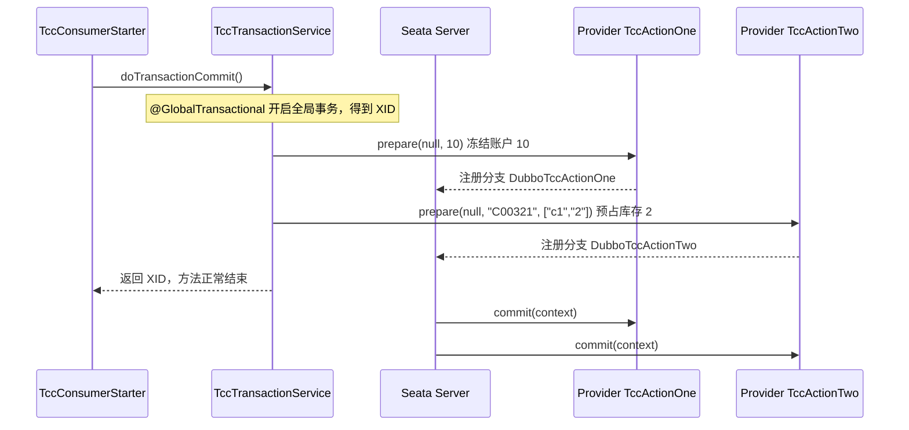

<!--
    Licensed to the Apache Software Foundation (ASF) under one or more
    contributor license agreements.  See the NOTICE file distributed with
    this work for additional information regarding copyright ownership.
    The ASF licenses this file to You under the Apache License, Version 2.0
    (the "License"); you may not use this file except in compliance with
    the License.  You may obtain a copy of the License at

    http://www.apache.org/licenses/LICENSE-2.0

    Unless required by applicable law or agreed to in writing, software
    distributed under the License is distributed on an "AS IS" BASIS,
    WITHOUT WARRANTIES OR CONDITIONS OF ANY KIND, either express or implied.
    See the License for the specific language governing permissions and
    limitations under the License.
-->

# TCC 示例说明

`tcc-sample` 里有两个结构相近的示例。`spring-dubbo-seata-tcc` 由 Consumer 发起全局事务，通过 Dubbo 调用 Provider 上的两个参与者。`springboot-sofarpc-seata-tcc` 使用同一套 Try、Confirm、Cancel 约定，RPC 换成 SOFARPC，发起方和参与者在同一个进程里。

两个示例操作同一套业务数据：账户库 `tcc_account` 和库存库 `tcc_storage`。一次下单会冻结余额并预占库存。全部 Try 成功后 Confirm 把冻结转成真实扣减；任一处失败后 Cancel 把冻结退回。

## TCC 在这里做什么

TCC 是两阶段提交，业务自己实现三个方法：

| 阶段 | 方法 | 谁调用 | 含义 |
| --- | --- | --- | --- |
| 一阶段 Try | `prepare` | 业务代码 | 预留资源 |
| 二阶段 Confirm | `commit` | Seata | 全部 Try 成功后，确认预留 |
| 二阶段 Cancel | `rollback` | Seata | 任一处失败后，释放预留 |

业务代码只调用 `prepare`。`commit` 和 `rollback` 由 Seata 在二阶段回调。

AT 模式由 Seata 解析 SQL 并生成回滚。TCC 用在业务自己才能撤销的操作上。这里的撤销对象是冻结余额和预占库存：Try 先把可用数量划到 `frozen`，Confirm 去掉冻结，Cancel 把数量加回可用。Seata 不写 `undo_log`。AT 与 XA 的差别见 [at-and-xa.md](at-and-xa.md)。

## 一次提交怎么走

入口是 `TccConsumerStarter`。它加载 `spring/seata-dubbo-reference.xml`，先跑提交，再跑回滚。



`doTransactionCommit()` 上有 `@GlobalTransactional`。方法正常返回后，Seata 对两个分支发 Confirm。

```47:65:tcc-sample/spring-dubbo-seata-tcc/spring-dubbo-seata-tcc-consumer/src/main/java/org/apache/seata/service/TccTransactionService.java
    @GlobalTransactional
    public String doTransactionCommit() {
        int[] accountBefore = dataReader.readAccount();
        int[] stockBefore = dataReader.readStock();
        //第一个TCC 事务参与者
        boolean result = tccActionOne.prepare(null, TccDataReader.AMOUNT);
        if (!result) {
            throw new RuntimeException("TccActionOne failed.");
        }
        List<String> list = new ArrayList<>();
        list.add("c1");
        list.add(String.valueOf(TccDataReader.COUNT));
        result = tccActionTwo.prepare(null, TccDataReader.COMMODITY_CODE, list);
        if (!result) {
            throw new RuntimeException("TccActionTwo failed.");
        }
        assertReserved(accountBefore, stockBefore);
        return RootContext.getXID();
    }
```

`TccDataReader.AMOUNT` 是 `10`，`COUNT` 是 `2`，商品编码是 `C00321`。两个 `prepare` 返回后、全局事务还没 Confirm 时，`assertReserved` 再读一次库：可用余额少 10、冻结加 10，可用库存少 2、冻结加 2。方法返回后 Seata 才 Confirm，Starter 再核对冻结已经释放、可用数量保持扣减后的值。

`doTransactionRollback()` 走同样的两次 `prepare`，最后抛出 `transaction rollback`。Starter 接住这个异常，Seata 对两个分支发 Cancel。

Provider 日志顺序是：`prepare`、`prepare`、`commit`，然后又是 `prepare`、`prepare`、`rollback`。

## 注解和上下文

`prepare` 的第一个参数传的是 `null`。调用方不构造上下文。Seata 拦截 Try 方法时填入 `BusinessActionContext`，里面带有 XID，所以实现里 `actionContext.getXid()` 能拿到值。

`@TwoPhaseBusinessAction` 把 Try 和二阶段方法绑在一起：

```37:42:tcc-sample/spring-dubbo-seata-tcc/spring-dubbo-seata-tcc-provider/src/main/java/org/apache/seata/action/impl/TccActionOneImpl.java
    @TwoPhaseBusinessAction(name = "DubboTccActionOne", commitMethod = "commit", rollbackMethod = "rollback")
    public boolean prepare(BusinessActionContext actionContext, @BusinessActionContextParameter(paramName = "a") int a) {
        String xid = actionContext.getXid();
        accountStore.tryReserve(xid, USER_ID, a);
        System.out.println("TccActionOne prepare, xid:" + xid + ", a:" + a + ", account:[" + accountStore.describe(USER_ID) + "]");
        return true;
```

二阶段方法只有一个参数 `BusinessActionContext`，原来的 `a`、`b`、`c` 不会再传进来。`@BusinessActionContextParameter` 在 Try 时把参数存进上下文，Confirm 和 Cancel 用 `actionContext.getActionContext("a")` 取回。

Action Two 的 `b` 是商品编码 `"C00321"`。`c` 标注了 `index = 1`，存的是列表下标 1 的 `"2"`，也就是预占数量。下标 0 的 `"c1"` 不进入二阶段上下文。

```35:44:tcc-sample/spring-dubbo-seata-tcc/spring-dubbo-seata-tcc-provider/src/main/java/org/apache/seata/action/impl/TccActionTwoImpl.java
    @TwoPhaseBusinessAction(name = "DubboTccActionTwo", commitMethod = "commit", rollbackMethod = "rollback")
    public boolean prepare(BusinessActionContext actionContext, @BusinessActionContextParameter(paramName = "b") String b,
                           @BusinessActionContextParameter(paramName = "c", index = 1) List list) {
        String xid = actionContext.getXid();
        int count = Integer.parseInt(String.valueOf(list.get(1)));
        stockStore.tryReserve(xid, b, count);
        System.out.println("TccActionTwo prepare, xid:" + xid + ", b:" + b + ", c:" + list.get(1)
            + ", stock:[" + stockStore.describe(b) + "]");
```

`ResultHolder` 仍是进程内的 `Map`。Confirm 写入 `T`，Cancel 写入 `R`。能不能对上，以两张业务表为准。Consumer 在 Try 之后、Confirm 之后、Cancel 之后各读一次账户和库存。

## 两张库里的数字

初始数据在 `e2e-files/sqlsh/all.sql`。账户 `U100001` 的 `money` 是 100，`frozen` 是 0。商品 `C00321` 的 `count` 是 100，`frozen` 是 0。

| 时机 | account.money | account.frozen | stock.count | stock.frozen |
| --- | --- | --- | --- | --- |
| 启动 | 100 | 0 | 100 | 0 |
| 提交事务的 Try 之后 | 90 | 10 | 98 | 2 |
| Confirm 之后 | 90 | 0 | 98 | 0 |
| 回滚事务的 Try 之后 | 80 | 10 | 96 | 2 |
| Cancel 之后 | 90 | 0 | 98 | 0 |

账户固定写 `U100001`。金额来自参数 `a`。商品编码来自参数 `b`，数量来自 `c`。每个分支在自己的库里还有一张事务表：`account_tx` 或 `stock_tx`。Try 插入 `TRY`，Confirm 改成 `CONFIRM`，Cancel 改成 `CANCEL`。同一 XID 再进来不会重复扣减。Cancel 先到、Try 还没写入时，会先记下 `CANCEL`，后面的 Try 直接失败，避免悬挂。

这两次本地提交各自独立。账户 Try 已经提交之后，如果库存 Try 失败，Seata 会对账户发 Cancel，把冻结的 10 加回去。

## 真正执行的是 Provider 里的实现

Consumer 和 Provider 的 Java 源码几乎是复制的。运行时执行的是 Provider 注册出去的实现。

- Provider 的 `seata-dubbo-provider.xml` 用 `dubbo:service` 把 `TccActionOneImpl`、`TccActionTwoImpl` 注册到 ZooKeeper。
- Consumer 的 `seata-dubbo-reference.xml` 用 `dubbo:reference` 订阅这两个接口，再注入 `TccTransactionService`。
- 两边都有 `GlobalTransactionScanner`，事务分组都是 `my_test_tx_group`。Consumer 是事务发起方，Provider 是资源管理方。

看 Try、Confirm、Cancel 的实现时，打开 Provider 模块里的同名类。Consumer 模块里的 `TccActionOneImpl` 不会被这次 Dubbo 调用执行。

注册中心地址是 `zookeeper://${zookeeper.address:127.0.0.1}:2181`。Compose 把 `zookeeper.address` 设成 ZooKeeper 服务名。`TccProviderStarter` 里内嵌 ZooKeeper 的代码已经注释掉。

## 读代码时可以跳过的部分

`TccTransactionService.checkBranchTransaction` 没有被 Starter 调用。它在回滚时期望结果是 `"F"`，而 `rollback` 实际写入的是 `"R"`。这是遗留代码，不影响这个 demo。

## SOFARPC 示例

`springboot-sofarpc-seata-tcc` 把发起方和两个参与者放在同一个进程。ZooKeeper 是应用内嵌的 `TestingServer`，端口 `2181`，Compose 里没有单独的 ZooKeeper 服务。

`TccActionOneImpl` 用 `@SofaService` 发布。Try 方法上的注解是 `@TwoPhaseBusinessAction(name = "SofaTccActionOne", commitMethod = "commit", rollbackMethod = "rollback")`，Action Two 的名字是 `SofaTccActionTwo`。

`TccTransactionService` 通过 `ReferenceFactoryBean` 拿到两个引用。TCC 拦截器加在这个工厂 Bean 上。`doTransactionCommit` 和 `doTransactionRollback` 仍然只调用 `prepare`，二阶段由 Seata 回调。账户和库存走两个数据源，库和 Dubbo 示例相同。
