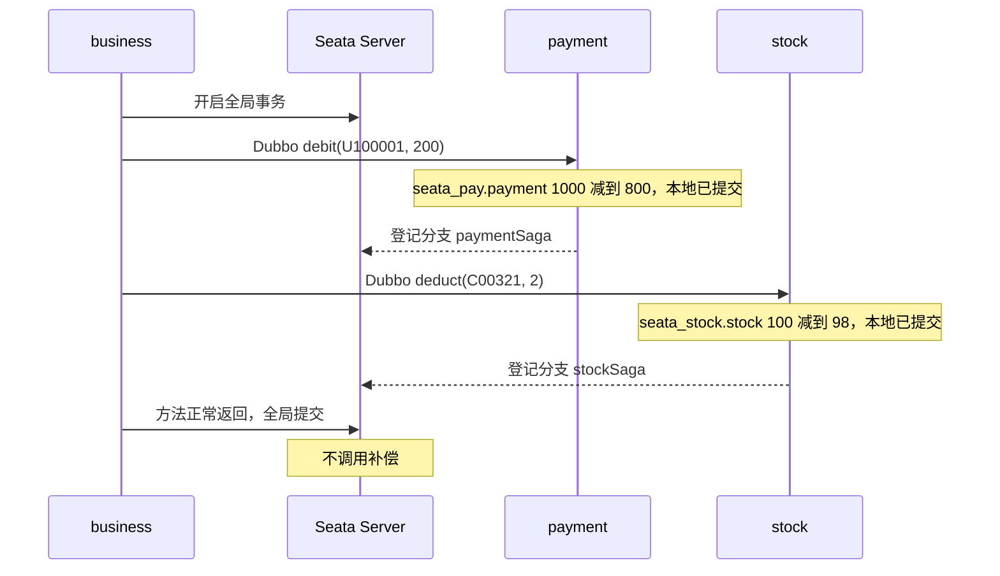

<!--
    Licensed to the Apache Software Foundation (ASF) under one or more
    contributor license agreements.  See the NOTICE file distributed with
    this work for additional information regarding copyright ownership.
    The ASF licenses this file to You under the Apache License, Version 2.0
    (the "License"); you may not use this file except in compliance with
    the License.  You may obtain a copy of the License at

    http://www.apache.org/licenses/LICENSE-2.0

    Unless required by applicable law or agreed to in writing, software
    distributed under the License is distributed on an "AS IS" BASIS,
    WITHOUT WARRANTIES OR CONDITIONS OF ANY KIND, either express or implied.
    See the License for the specific language governing permissions and
    limitations under the License.
-->

# saga-annotation-sample

用 Dubbo 把注解式 Saga 拆成两个参与者。支付服务只写 `seata_pay.payment`，库存服务只写 `seata_stock.stock`。业务服务没有自己的表，它负责开启全局事务，并通过 Dubbo 调用这两个参与者。

一次购买：用户 `U100001` 买 2 件商品 `C00321`，单价 100，所以支付扣 200，库存扣 2。每次请求开始前都会把两张表重置为余额 1000、库存 100。

## 和 TCC 的差别

正向方法一调用就在自己的数据库里提交。全局事务成功时，Seata 不会再回调。全局事务失败时，Seata 按登记的反序调用补偿方法，把已经提交的本地修改加回去。

数据源代理是关掉的（`seata.enable-auto-data-source-proxy=false`）。否则 Seata 会按 AT 再记一份 `undo_log`，回滚时退两次款。

## 三个进程

| 进程 | 角色 | 数据 |
| --- | --- | --- |
| `saga-annotation-business` | 事务发起方，端口 8088 | 无 |
| `saga-annotation-payment` | Dubbo 参与者 `paymentSaga` | 库 `seata_pay`，表 `payment` |
| `saga-annotation-stock` | Dubbo 参与者 `stockSaga` | 库 `seata_stock`，表 `stock` |

Dubbo 注册中心是 ZooKeeper。Seata 的 Dubbo Filter 把 XID 带到提供方线程。提供方上的 `@CompensationBusinessAction` 向事务协调器登记分支。

`PaymentDubboService` 只做远程入口，真正带注解的是 `PaymentSagaAction`。库存侧同样分成 `StockDubboService` 和 `StockSagaAction`。这样 Dubbo 进来的调用会再进一次 Spring 代理，分支才会登记。补偿方法不暴露成 Dubbo 接口，由协调器在回滚时直接回调提供方进程。

## 提交

`GET /purchase/commit` 调用 `SagaPurchaseService.commitPurchase()`。这个方法上有 `@GlobalTransactional`。



返回类似：

```text
提交 xid=...
seata_pay.payment userId=U100001 balance 1000 -> 800
seata_stock.stock commodityCode=C00321 count 100 -> 98
```

## 回滚

`GET /purchase/rollback` 走同一组正向调用。两次扣减都在各自库里提交之后，业务方法抛出 `SagaRollbackSignal`。`@GlobalTransactional` 通知协调器回滚。协调器先补偿库存，再补偿支付。补偿方法从 `BusinessActionContext` 取出当初的 `userId`、`amount`、`commodityCode`、`count`，执行相反的 `UPDATE`。

```text
回滚 xid=...
seata_pay.payment userId=U100001 balance 1000 -> 1000
seata_stock.stock commodityCode=C00321 count 100 -> 100
```

接口返回前，全局回滚已经结束，所以这里读到的是补偿之后的值。提供方日志里能看到中间的 `1000 -> 800` 和 `100 -> 98`，以及补偿时加回去的那两行。

## 运行

```bash
docker compose up --build
curl http://127.0.0.1:8088/purchase/commit
curl http://127.0.0.1:8088/purchase/rollback
docker compose down
```

MySQL 映射了 `3306`，用户 `user`，密码 `123456`。可以直接查看两张表：

```sql
SELECT user_id, balance FROM seata_pay.payment;
SELECT commodity_code, `count` FROM seata_stock.stock;
```

提供方日志：

```bash
docker compose logs -f saga-annotation-payment saga-annotation-stock
```
