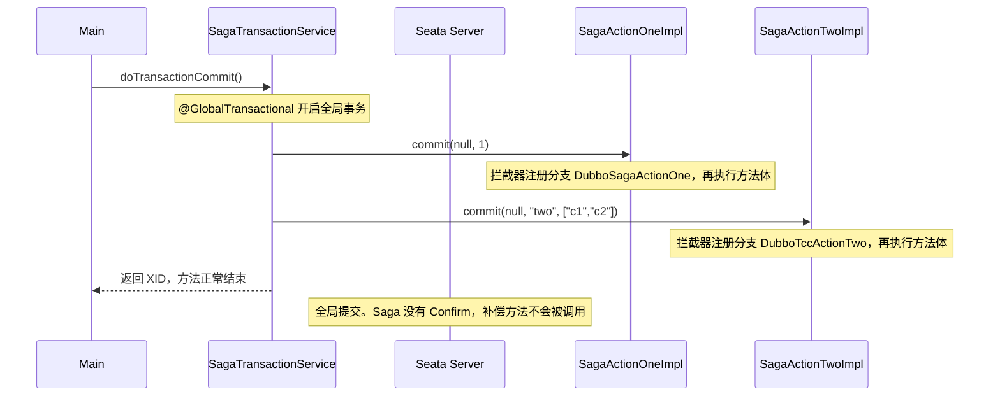
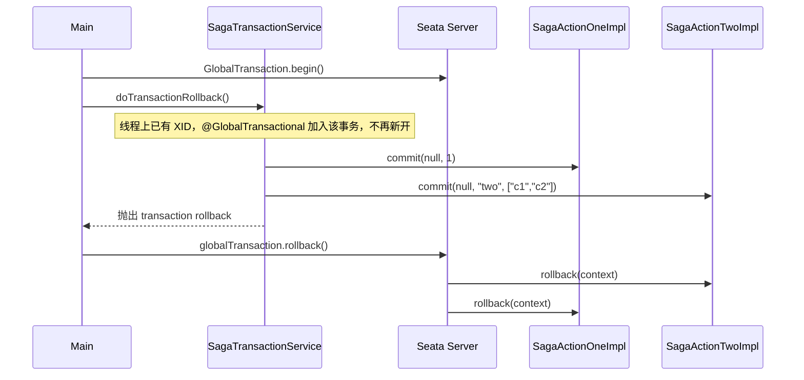

<!--
    Licensed to the Apache Software Foundation (ASF) under one or more
    contributor license agreements.  See the NOTICE file distributed with
    this work for additional information regarding copyright ownership.
    The ASF licenses this file to You under the Apache License, Version 2.0
    (the "License"); you may not use this file except in compliance with
    the License.  You may obtain a copy of the License at

    http://www.apache.org/licenses/LICENSE-2.0

    Unless required by applicable law or agreed to in writing, software
    distributed under the License is distributed on an "AS IS" BASIS,
    WITHOUT WARRANTIES OR CONDITIONS OF ANY KIND, either express or implied.
    See the License for the specific language governing permissions and
    limitations under the License.
-->

# saga-annotation-sample

单进程的注解式 Saga。两个本地参与者用 `@CompensationBusinessAction` 加入同一个全局事务。没有状态机 JSON，没有业务库，也没有 RPC。

先把名字理顺，否则会把它读成 TCC：

| 你在代码里看到的 | 在本示例里实际是 |
| --- | --- |
| `commit(...)` | Saga 的正向动作。业务一调用就执行完，不是 TCC 的二阶段 Confirm |
| `rollback(...)` | 补偿动作。只有全局事务失败时，由 Seata 回调 |
| 日志里的 `prepare` | 沿用 TCC 示例的打印文案，不代表还有 Try 阶段 |
| 类上的 `@LocalTCC` | 沿用 TCC 示例的类标记。本示例真正注册分支的是 `@CompensationBusinessAction` |

TCC 是 Try、Confirm、Cancel 三步：业务只调用 Try，成功后再由 Seata 调用 Confirm。注解式 Saga 只有两步。正向方法自己就是业务提交；全局事务成功时 Seata 什么都不再调用；失败时按登记顺序的反方向调用补偿方法。

## 一次成功提交

`Main` 启动 Spring 后调用 `SagaTransactionService.doTransactionCommit()`。这个方法上有 `@GlobalTransactional`，进入时向 TC 开启全局事务并得到 XID。



方法体只做了三件事：调用参与者一的正向方法，调用参与者二的正向方法，返回当前 XID。两个调用都返回 `true`，方法正常结束，Seata 提交全局事务。补偿方法不会执行。

业务代码传入的第一个参数是 `null`。Seata 拦截这次调用时会自己创建 `BusinessActionContext`，所以方法体里的 `actionContext.getXid()` 有值。拦截器先向 TC 登记分支，再进入方法体。分支名来自注解：参与者一是 `DubboSagaActionOne`，参与者二是 `DubboTccActionTwo`。`compensationMethod = "rollback"` 告诉 TC，这个分支失败时要回调哪个方法。

## 一次失败补偿

`Main` 接着用 API 再开一个全局事务，然后调用 `doTransactionRollback()`。



`doTransactionRollback()` 同样标了 `@GlobalTransactional`，默认传播行为是加入已有事务。`Main` 已经 `begin()`，所以这个方法是参与者，不是发起者。它把两个正向动作又跑一遍，然后主动抛出 `transaction rollback`。异常抛回 `Main` 的 `catch`，由 `Main` 调用 `globalTransaction.rollback()`。TC 按登记的反序回调两个 `rollback`：先参与者二，再参与者一。

发起者放在 `Main` 里，是为了让样例在正向动作已经执行之后，显式触发全局回滚，并在回滚请求返回后继续等待。如果只靠 `@GlobalTransactional` 方法自己抛异常，拦截器也会回滚，只是回滚时机包在注解里，样例就看不出“谁在调用补偿”。

## 补偿方法怎么拿到当初的参数

补偿不是当初那次 Java 调用的继续，Seata 之后用新的 `BusinessActionContext` 回调 `rollback`。正向方法上的 `@BusinessActionContextParameter` 负责把参数存进上下文，补偿方法再用名字取回来。

参与者一：

```33:44:saga-annotation-sample/src/main/java/org/apache/seata/action/impl/SagaActionOneImpl.java
    public boolean commit(BusinessActionContext actionContext,@BusinessActionContextParameter(paramName = "a") int a) {
        // ...
    }

    public boolean rollback(BusinessActionContext actionContext) {
        Object a =  actionContext.getActionContext("a");
        // ...
    }
```

`paramName = "a"` 把整数 `1` 记到上下文。`rollback` 没有业务参数，只能 `getActionContext("a")`。

参与者二有两个参数。`b` 整段保存，值是 `"two"`。`c` 是 `List`，注解写了 `index = 1`，所以存进上下文的不是整个列表，而是下标 1 的元素 `"c2"`。正向方法里 `list.get(1)` 读的是同一次调用的原始列表；补偿方法里 `getActionContext("c")` 读到的是当初抽出来的 `"c2"`。

## Main 为什么要等一个 Future

`ResultHolder` 按 XID 保存参与者二的 `CompletableFuture`。正向方法里创建它、放进去，并立刻 `complete(null)`。补偿方法再按同一个 XID 取出来，再 `complete` 一次。`Main` 两段流程都 `get(10, TimeUnit.SECONDS)`。

成功路径上，Future 在正向方法返回前就已经完成，这次等待会马上返回。失败路径上，正向方法同样已经把它完成了，补偿里的第二次 `complete` 不会再改变结果，`Main` 也不是在等补偿结束。它的作用是让进程在参与者二的正向方法跑完之前不要退出。补偿日志来自 `rollback()` 调用 TC 时的同步回调，不依赖这个 Future。

## 跑起来看什么

```bash
docker compose up --build
docker compose logs -f saga-annotation-sample
docker compose down
```

`application.yml` 用 `SEATA_SERVER_ADDR` 连接 TC，默认 `127.0.0.1:8091`。Compose 把它设为 `seata:8091`。

成功路径打印两行正向日志后结束：

```text
TccActionOne prepare, xid:..., a:1
TccActionTwo prepare, xid:..., b:two, c:c2
```

失败路径会再打印这两行，然后打印补偿。参与者一的补偿日志文案仍是 `prepare`，参与者二才打印 `rollback`：

```text
TccActionOne prepare, xid:..., a:1
TccActionTwo rollback, xid:..., b:two, c:c2
```
